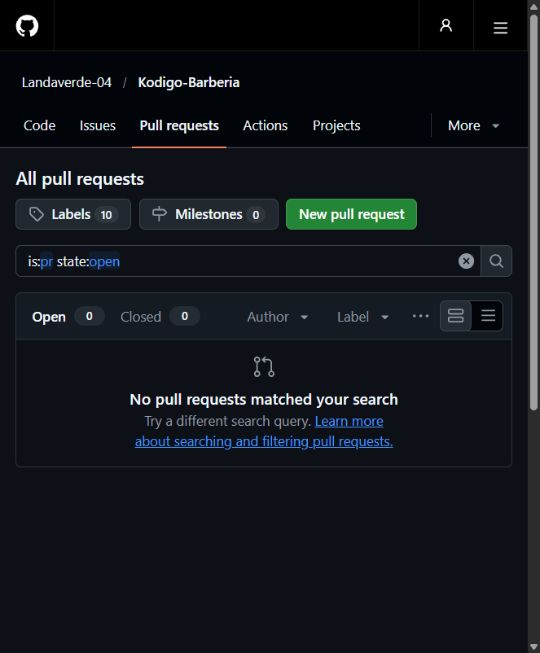
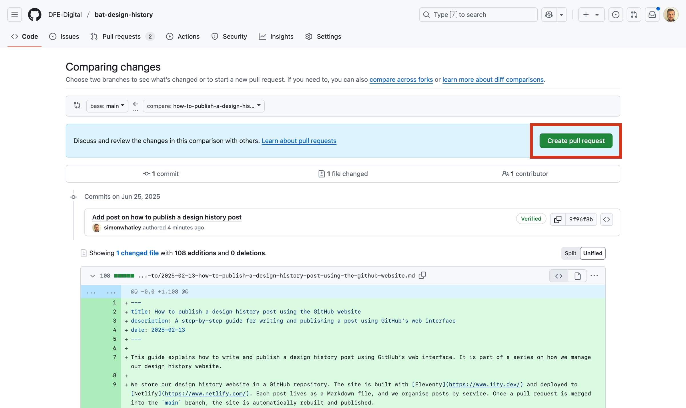
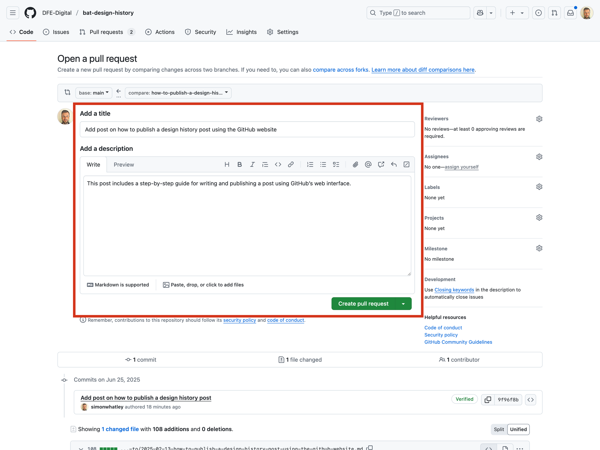

# GitHub: tu rama y tu Pull Request

Repositorio: [Kodigo-Barberia](https://github.com/Landaverde-04/Kodigo-Barberia).

## 1. Elige tu rama

Abre PowerShell en la carpeta del proyecto. Copia **solo la línea de tu persona**:

| Persona | Línea que debes ejecutar |
|---|---|
| Landaverde-04 | `$rama = "feat/landaverde-registro"` |
| Samuel | `$rama = "feat/samuel-reservas"` |
| Max | `$rama = "feat/max-catalogo"` |
| Wilber | `$rama = "feat/wilber-agenda"` |

Con tus cambios anteriores guardados y `git status` limpio:

```powershell
git switch main
git pull --ff-only origin main
git switch -c $rama
```

Comprueba con `git branch --show-current` que estás en tu rama. Si ya existe, usa `git switch $rama`; no la crees otra vez. Conserva la misma terminal para que exista la variable `$rama`.

## 2. Programa y sube tus cambios

Trabaja en tus carpetas y consulta tu documento individual, que está en la raíz. Antes de subir, revisa `git status` y `git diff`, comprueba el sistema y sus pruebas.

Añade todos los cambios de tu entrega desde la raíz del proyecto:

```powershell
git add .
git diff --cached --stat
git commit -m "feat: describe aqui tu cambio"
git push -u origin $rama
```

Cambia el mensaje por una descripción real. No subas `.env`, contraseñas ni cambios de otros compañeros.

## 3. Abre el Pull Request

En GitHub, abre el repositorio → **Pull requests** → **New pull request**. Si aparece el aviso **Compare & pull request**, también sirve.



## 4. Revisa la dirección de los cambios

Selecciona **base: main** y **compare: tu rama**. Revisa los archivos y pulsa **Create pull request**.



Si ambos selectores dicen main, o no hay cambios distintos, no podrás abrir el PR. Vuelve a elegir tu rama y confirma que hiciste commit y push.

## 5. Escribe el título y la explicación

Pon un título concreto, por ejemplo `feat: agrega catálogo de servicios`. En la descripción escribe qué hiciste, cómo lo probaste y si tocaste algo compartido. Pulsa **Create pull request** y continúa para integrar tú mismo tu entrega.



Crear el PR propone tus cambios; todavía no los incorpora a main. Si necesitas corregir algo, haz nuevos commits y push a la misma rama: el PR se actualizará.

## 6. Integra tú mismo tu PR

El mismo autor comprueba **Files changed** y sus pruebas, y pulsa **Merge pull request** → **Confirm merge**. No necesita esperar revisión ni aprobación de otro compañero. Integra los cambios de la entrega en un solo PR.

**Importante:** no pulses **Close pull request** para integrar: ese botón lo cierra sin pasar los cambios a main. Al usar Merge y confirmar, GitHub lo integra y lo cierra como **Merged**. Si GitHub bloquea la integración por conflictos o reglas, consulta al responsable.

Después de que el PR figure como **Merged**, vuelve a tu equipo y actualiza:

```powershell
git switch main
git pull --ff-only origin main
```

Para la siguiente entrega crea una rama nueva con un nombre nuevo. Si hay conflictos, consulta al equipo; no uses `push --force` ni aceptes todos los cambios automáticamente.

**Regla del equipo:** cada persona trabaja en su rama; cada autor integra su entrega completa a main mediante su propio Pull Request, sin revisión obligatoria. Modelos, migraciones y archivos compartidos se cambian de forma coordinada.

Captura del repositorio: lectura pública del proyecto. Las imágenes de comparación y formulario son ejemplos del Department for Education británico; sus nombres no se deben copiar. [Fuente y licencia OGL v3](https://becoming-a-teacher.design-history.education.gov.uk/how-to/how-to-publish-a-design-history-post-using-the-github-website/).

Referencia de los pasos: [crear un PR](https://docs.github.com/en/pull-requests/how-tos/create-pull-requests/creating-a-pull-request), [revisión](https://docs.github.com/en/pull-requests/how-tos/create-pull-requests/requesting-a-pull-request-review) y [merge](https://docs.github.com/en/pull-requests/how-tos/merge-and-close-pull-requests/merging-a-pull-request).
