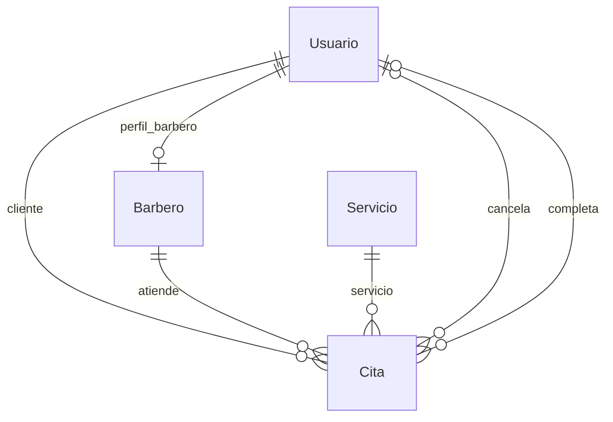

# Modelos compartidos

Esta es la base de datos común. Los modelos reales están en el código; no crear equivalentes en otras apps. Las políticas de roles, horario y cancelación están aprobadas en docs/DECISIONES.md.

## Relaciones

El cliente es un Usuario; no existe una tabla Cliente. Un Usuario tiene como máximo un perfil Barbero. El rol y el perfil son conceptos distintos: la asignación deberá mantenerlos coherentes.

## seguridad.Usuario

Modelo existente: hereda únicamente de AbstractUser. Campos de Django: username, password, first_name, last_name, email, is_active, is_staff, is_superuser, date_joined, last_login, groups y user_permissions. Campo propio: debe_cambiar_password.

Conservar AUTH_USER_MODEL = seguridad.Usuario y las migraciones 0001/0002 ya compartidas. En relaciones utilizar settings.AUTH_USER_MODEL; en código de ejecución, get_user_model(). No crear accounts.User ni mover las tablas.

## core.ModeloBase

Abstracto, sin tabla propia. Añade a Servicio, Barbero y Cita:

| Campo | Tipo | Uso |
|---|---|---|
| fecha_creacion | DateTime auto_now_add | Momento de creación |
| fecha_modificacion | DateTime auto_now | Última modificación |
| activo | Boolean, True | Baja lógica general |

En Cita, activo NO representa el estado ni libera un horario. Solo estado=CANCELLED libera el intervalo. No ocultar citas al cliente o barbero basándose en activo para simular cancelación.

## services.Servicio

| Campo | Tipo | Contrato |
|---|---|---|
| id | BigAutoField | Identificador estable |
| nombre | CharField(100) | Nombre obligatorio |
| descripcion | TextField | Opcional |
| precio | Decimal(8,2) | No negativo; no usar float |
| duracion_minutos | PositiveSmallInteger | Mayor que cero |
| imagen | ImageField | Opcional; ruta servicios/ |

Más los campos de ModeloBase. La duración debe ser múltiplo de 15; lo validan el modelo y una restricción PostgreSQL. Editar precio o duración no modifica las copias históricas de las citas.

## barbers.Barbero

| Campo | Tipo | Contrato |
|---|---|---|
| id | BigAutoField | Identificador que recibe el módulo de citas |
| usuario | OneToOne Usuario, PROTECT | related_name=perfil_barbero |
| descripcion | TextField | Opcional |
| foto | ImageField | Opcional; ruta barberos/ |

Más ModeloBase. Los datos personales se leen de usuario; no copiar username o email al perfil. No crear tablas de horarios individuales. Para mostrar el nombre, usar nombre completo o username.

## appointments.Cita

| Campo | Tipo | Contrato |
|---|---|---|
| cliente | FK Usuario, PROTECT | related_name=citas_cliente |
| barbero | FK Barbero, PROTECT | related_name=citas |
| servicio | FK Servicio, PROTECT | related_name=citas |
| fecha_inicio / fecha_fin | DateTime | Instantes con zona horaria |
| nombre_servicio_reservado | CharField(100) | Copia histórica del nombre |
| precio_reservado | Decimal(8,2) | Copia histórica del precio |
| duracion_reservada | PositiveSmallInteger | Copia histórica de la duración en minutos |
| estado | CharField(10) | CONFIRMED por defecto, CANCELLED o COMPLETED |
| fecha_cancelacion | DateTime nullable | Solo para canceladas |
| cancelada_por | FK Usuario nullable, PROTECT | related_name=citas_canceladas |
| motivo_cancelacion | TextField | Opcional |
| fecha_finalizacion | DateTime nullable | Solo para completadas |
| completada_por | FK Usuario nullable, PROTECT | related_name=citas_completadas |

Más id y ModeloBase. Importar las opciones desde `appointments.models.EstadoCita`; no crear otro enum ni añadir PENDING.

## Qué protege ya la base de datos

- Fin posterior al inicio, precio no negativo, duración positiva y estados válidos.
- Fechas y actores de auditoría coherentes con el estado.
- No pueden superponerse citas no canceladas del mismo barbero, incluso con escrituras concurrentes.
- Se admiten intervalos contiguos: [08:00,08:30) y [08:30,09:00).
- Se admiten citas simultáneas de barberos diferentes.
- PROTECT evita borrar las relaciones necesarias para el historial.

La exclusión usa PostgreSQL y btree_gist. Su instalación se incluye en la migración nueva de appointments. La cuenta local propietaria de la base puede instalar esta extensión trusted. Si falla por permisos o por archivos faltantes, consultar al equipo; no eliminar la restricción.

## Qué debe validar todavía la lógica de negocio

Roles y propiedad, recursos activos, fecha futura, horario común, alineación del inicio, duración aceptada, copias obtenidas del servidor, transiciones autorizadas y límites temporales. Cita.clean comprueba que fin-inicio coincida con duracion_reservada, pero Django no llama automáticamente full_clean al ejecutar save. Samuel debe validar explícitamente en su servicio compartido.

Los modelos no sustituyen el flujo de reserva. No exponer un ModelForm de Cita con todos los campos. El cliente no envía precio, duración, identidad de cliente ni estado. CitaAdmin es solo consulta hasta que existan las operaciones seguras.

## Cambios de esquema

Leer TRABAJO_EN_EQUIPO.md. No cambiar campos o related_name para resolver una pantalla propia. Consultar primero con el usuario y el dueño del módulo. No modificar las migraciones previas de seguridad.
